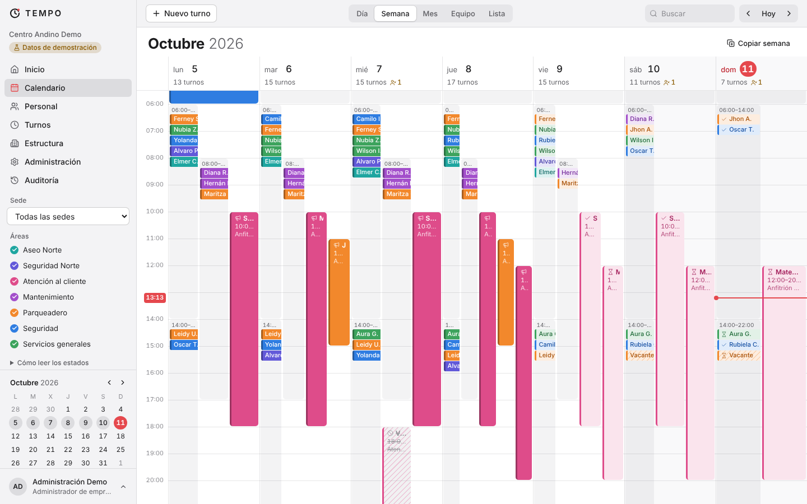
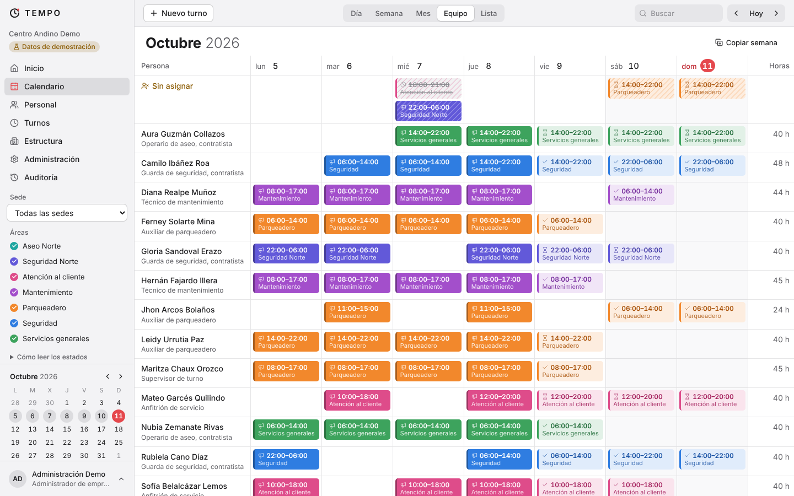
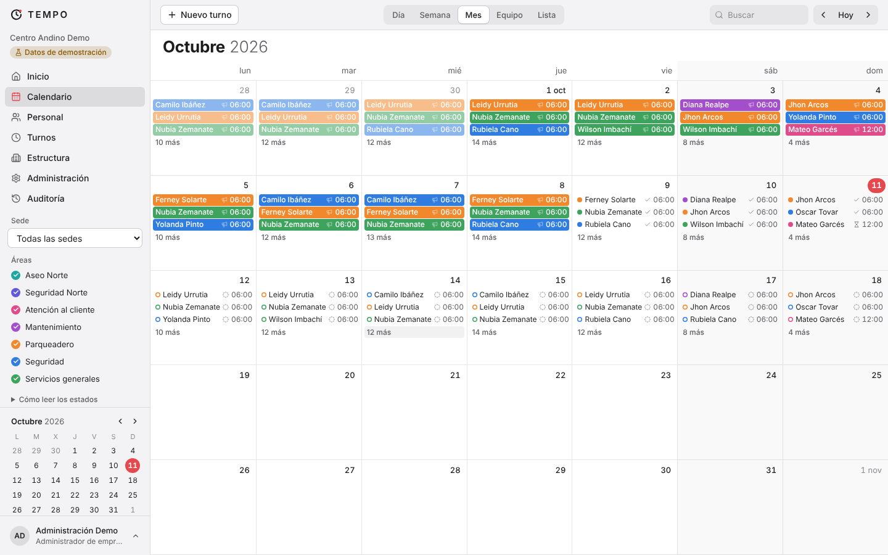

# TEMPO

Programación de turnos y gestión de personal para empresas. *El tiempo, mejor organizado.*

Este repositorio contiene la **Fase 1 (base funcional)**: autenticación, varias empresas aisladas entre sí, roles y permisos, sedes, áreas, cargos, personal, plantillas de turno, calendario operativo con flujo de aprobación, auditoría y una empresa de demostración.

> **Estado:** en desarrollo. No está listo para producción. TEMPO todavía **no valida reglas laborales ni calcula costos**; eso llega en las fases 2 y 3. El detalle de lo hecho, lo probado y lo pendiente está en [docs/ESTADO.md](docs/ESTADO.md).



| Vista por equipo | Vista mensual |
| --- | --- |
|  |  |

## Qué incluye

- **Calendario** con vistas de día, semana, mes, equipo (una fila por persona) y lista. Crear, editar, arrastrar para mover, estirar para cambiar la duración, copiar una semana a la siguiente. Modo claro y oscuro.
- **Turnos que cruzan la medianoche**, tratados como un solo turno y dibujados en los dos días.
- **Flujo de aprobación**: borrador → pendiente de aprobación → aprobado → publicado. Un turno aprobado o publicado no se puede cambiar sin reabrirlo con un motivo. Separación de funciones opcional: quien edita no aprueba.
- **Personal** con empleados directos y contratistas diferenciados; los datos contractuales solo los ven los roles autorizados.
- **Auditoría** de solo inserción: quién, qué, cuándo, valores anteriores y motivo.
- **Aislamiento entre empresas** en la base de datos (Row-Level Security de PostgreSQL), además de las comprobaciones de la aplicación.

## Requisitos

- Node.js 22 o superior
- PostgreSQL 16 o superior (se incluye `docker-compose.yml` para levantarlo en local)

## Puesta en marcha en local

```bash
docker compose up -d            # PostgreSQL con las bases tempo_dev y tempo_test
cp .env.example .env            # y define DEMO_PASSWORD (mínimo 10 caracteres)
npm install
npm run db:migrate              # crea tablas, políticas de seguridad y el rol tempo_app
npm run db:seed                 # empresa de demostración con datos ficticios
npm run dev                     # http://localhost:3000
```

Usuarios de la demostración (la contraseña es la que pusiste en `DEMO_PASSWORD`):

| Correo | Rol | Para probar |
| --- | --- | --- |
| `demo@tempo.example` | Administrador de empresa | Todo, incluida la aprobación y la publicación |
| `coordinacion@tempo.example` | Coordinador de programación | Programar y enviar a aprobación |
| `auditoria@tempo.example` | Auditor de consulta | Solo lectura y auditoría |

También puedes crear una empresa vacía desde `/registro`.

## Comandos

| Comando | Qué hace |
| --- | --- |
| `npm run dev` | Servidor de desarrollo |
| `npm run build` y `npm start` | Compilar y servir en modo producción |
| `npm run lint` y `npm run typecheck` | Análisis estático |
| `npm test` | Pruebas unitarias y de aislamiento entre empresas (usa `TEST_DATABASE_URL`) |
| `npm run test:e2e` | Pruebas de extremo a extremo con Playwright |
| `npm run db:generate -- --name <nombre>` | Genera una migración a partir de `src/db/schema.ts` |
| `npm run db:migrate` | Aplica las migraciones |
| `npm run db:seed` | Recrea la empresa de demostración |

Las pruebas **borran y recrean** la base indicada en `TEST_DATABASE_URL`. Por seguridad se niegan a correr si el nombre de esa base no contiene `test`.

## Variables de entorno

| Variable | Uso |
| --- | --- |
| `DATABASE_URL` | Conexión a PostgreSQL de la aplicación |
| `TEST_DATABASE_URL` | Base desechable para las pruebas |
| `DEMO_PASSWORD` | Contraseña de los usuarios de demostración que crea `db:seed` |

Ningún secreto se guarda en el repositorio: `.env` está ignorado por git.

## Estructura

```
drizzle/                 Migraciones SQL (0001 contiene la seguridad por empresa)
scripts/                 Migrar y sembrar la demo
src/db/                  Esquema y conexión (withTenant)
src/lib/                 Permisos, estados del turno, tiempo, auditoría, sesión
src/app/(auth)/          Ingreso y registro
src/app/(app)/           Módulos: inicio, calendario, personal, turnos, estructura, administración, auditoría
src/components/calendar/ Vistas del calendario y editor de turnos
tests/                   Unitarias y de integración (Vitest)
e2e/                     Extremo a extremo (Playwright)
docs/                    Arquitectura, decisiones y estado
```

## Despliegue

Aún no se ha desplegado en ningún entorno. La aplicación es un proyecto Next.js estándar con una base PostgreSQL, así que funciona en cualquier plataforma que ofrezca ambas cosas. Antes de exponerla a usuarios reales hay que resolver los pendientes de seguridad y operación listados en [docs/ESTADO.md](docs/ESTADO.md).

El usuario de base de datos debe poder crear la extensión `btree_gist` y el rol `tempo_app` (las migraciones lo hacen).

## Documentación

- [Arquitectura](docs/ARQUITECTURA.md)
- [Decisiones técnicas](docs/DECISIONES.md)
- [Estado, pruebas y pendientes](docs/ESTADO.md)
